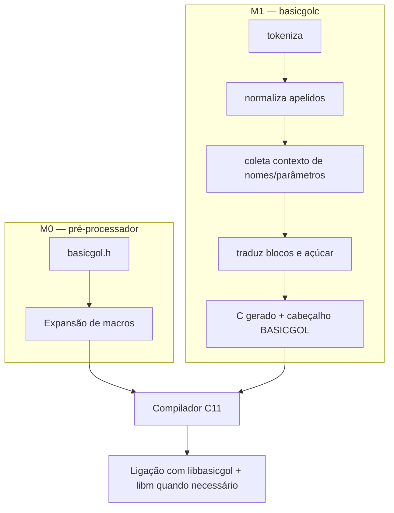

# Arquitetura e fluxo de tradução

## Componentes

| Componente | Responsabilidade | Referência |
|---|---|---|
| `include/basicgol.h` | Palavras-chave, tipos, operadores, seleção `_Generic` e apelidos curtos | [Macros](/referencia/linguagem/) |
| `include/basicgol/*.h` | Contratos públicos dos módulos da biblioteca | [Funções](/referencia/funcoes/) |
| `src/biblioteca/*.c` | Implementação portátil ligada ao programa | [Funções](/referencia/funcoes/) |
| `tools/basicgolc.c` | Tradução tokenizada M1, validação de blocos e avisos | [Transpilador](/internos/) |
| `tests/` | Casos dourados, harness unitário, runners, portabilidade e fuzz | [Testes](/testes/) |
| `tools/gerar_documentacao.py` | Extração automática e publicação deste site | [Manutenção](/guias/publicacao) |

## M0 e M1 não são compiladores concorrentes

O transpilador não resolve tipos nem executa o pré-processador C. Construtores de valor permanecem prefixados no C gerado para que a tabela de formatos e as verificações de tipo continuem em um único lugar: o cabeçalho.

## Propriedade e erros

- Buffers de texto têm capacidade explícita em bytes, incluindo NUL; não há redimensionamento automático.
- Funções recuperáveis devolvem `bool` e preservam a saída em falha quando o contrato declara isso.
- Erros como divisor zero em `DIVIDE` e passo zero em `PARA_PASSO` são fatais por decisão de projeto.
- O transpilador usa códigos de saída distintos para sucesso, erro de estrutura e erro de uso; falhas internas fatais usam 70.

## Onde procurar cada detalhe

Cada página de símbolo foi montada a partir da definição real. A seção **Como este símbolo aparece nos testes** lista arquivos e linhas; **Evidência indireta** mostra chamadores; **Compiladores, padrão C e sistema operacional** mostra guards e ressalvas. O [guia de leitura](/guias/como-ler) explica os limites dessas evidências.
