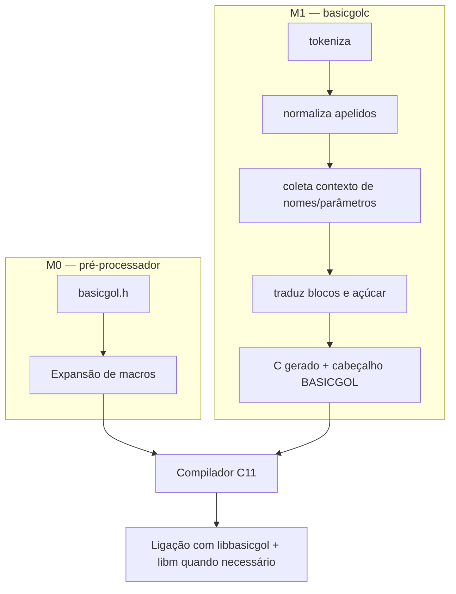
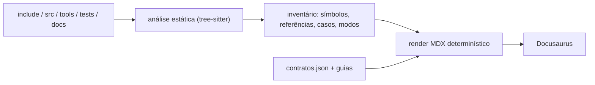

# Arquitetura e fluxo de tradução

## Componentes

| Componente | Responsabilidade | Referência |
|---|---|---|
| `include/basicgol.h` | Palavras-chave, tipos, operadores, seleção `_Generic` e apelidos curtos | [Macros](/referencia/linguagem/) |
| `include/basicgol/*.h` | Contratos públicos dos módulos da biblioteca | [Funções](/referencia/funcoes/) |
| `src/biblioteca/*.c` | Implementação portátil ligada ao programa | [Funções](/referencia/funcoes/) |
| `tools/basicgolc.c` | Tradução tokenizada M1, validação de blocos e avisos | [Transpilador](/internos/) |
| `tests/` | Casos dourados, harness unitário, runners, portabilidade e fuzz | [Testes](/testes/) |
| `tools/gerar_documentacao.py` | Extração automática e publicação deste site | [Manutenção](/guias/publicacao) |

## M0 e M1 não são compiladores concorrentes



O transpilador não resolve tipos nem executa o pré-processador C. Construtores de valor
permanecem prefixados no C gerado para que a tabela de formatos e as verificações de tipo
continuem em um único lugar: o cabeçalho.

### O que cada etapa faz — e o que ela não faz

| Etapa | Faz | Não faz |
|---|---|---|
| Pré-processador C | substitui macros, avalia `#if`, inclui cabeçalhos | não valida blocos, não reordena tokens, não conhece tipos |
| `basicgolc` | tokeniza, normaliza apelidos, insere chaves, desaçucara `PARA i DE …`, emite W-01…W-07 | não compila, não liga, não expande macros, não resolve tipos |
| Compilador C | verifica sintaxe e tipos, otimiza, gera código | não conhece palavras-chave em português além das macros |
| Ligação | combina objetos com `libbasicgol.a` e libm | não valida contrato de uso da biblioteca |

Essa separação é a razão de a documentação distinguir “expansão de macro” de “tradução
do transpilador”: são mecanismos diferentes, com garantias diferentes.

## Um exemplo de ponta a ponta

Fonte:

```c
INICIO
    INTEIRO i = 0;
    PARA i DE 1 ATE 3 FACA
        ESCREVAL(i);
    FIM_PARA
FIM
```

Depois de `basicgolc` (forma conceitual; a saída real preserva o restante do texto):

```c
int main(void) {
    int i = 0;
    for (i = 1; i <= 3; i += 1) {
        ESCREVAL(i);
    }
}
```

Depois do pré-processador + compilador C, `ESCREVAL` vira uma chamada de escrita com o
formato escolhido por `_Generic`. O binário final não contém nenhum interpretador.

## Propriedade e erros

- Buffers de texto têm capacidade explícita em bytes, incluindo NUL; não há
  redimensionamento automático.
- Funções recuperáveis devolvem `bool` e preservam a saída em falha quando o contrato
  declara isso.
- Erros como divisor zero em `DIVIDE` e passo zero em `PARA_PASSO` são fatais por
  decisão de projeto.
- O transpilador usa códigos de saída distintos para sucesso, erro de estrutura e erro
  de uso; falhas internas fatais usam 70.

### Contrato de retorno em uma tabela

| Situação | Mecanismo | Efeito |
|---|---|---|
| Entrada inválida, truncamento, conversão incompleta | retorno `LOGICO` = `false` | destino numérico preservado; string vazia quando há espaço para NUL |
| Operação matemática não definida ou não representável | `ERRO` / `bg_erro` | mensagem em stderr e status 1 |
| Passo zero em laço contado | `bg_passo_zero` | diagnóstico antes da primeira iteração |
| Erro de bloco no M1 | diagnóstico do `basicgolc` | tradução recusada, sem C gerado |
| Falha interna do transpilador | código 70 | encerramento sem tentar gerar saída parcial |

## Como o site é montado a partir desta arquitetura

O gerador não compila C: ele lê a árvore, extrai símbolos, referências e diretivas e
renderiza MDX. É por isso que a documentação consegue mostrar ramos de compilador sem
escolher um alvo — o `#if` continua visível na página.



## Onde procurar cada detalhe

Cada página de símbolo foi montada a partir da definição real. A seção **Como este
símbolo aparece nos testes** lista arquivos e linhas; **Evidência indireta** mostra
chamadores; **Compiladores, padrão C e sistema operacional** mostra guards e ressalvas.
O [guia de leitura](/guias/como-ler) explica os limites dessas evidências.

## Perguntas frequentes

### `basicgolc` é um compilador?

Não. Ele é um tradutor de texto: tokeniza a fonte, valida a estrutura de blocos que as
macros não conseguem validar, desaçucara `PARA i DE … FACA` e escreve C. Tipos,
otimização e geração de código continuam com o compilador C.

```bash
build/basicgolc programa.c -o programa.gerado.c
cc -std=c11 -I include programa.gerado.c build/libbasicgol.a -lm -o programa
```

### Por que o C gerado ainda usa macros como `ESCREVAL`?

Para manter uma única implementação da tabela de formatos e das verificações de tipo.
Se o transpilador tentasse expandir `ESCREVAL`, ele precisaria reproduzir `_Generic` e
as regras de promoção — e as duas implementações divergiriam.

### O M1 pode alterar a semântica do meu programa?

Ele insere chaves e reescreve o açúcar. Não muda expressões, tipos ou ordem de
avaliação. Onde há risco conhecido — variável de controle alterada no corpo — ele avisa
com W-04. As chaves inseridas seguem a estrutura dos `FIM_*`, e blocos desbalanceados são
recusados.

### O que acontece se eu esquecer um `FIM_SE`?

No M0 o erro aparece como erro de sintaxe do C, muitas vezes apontando para uma linha
distante. No M1 o transpilador detecta o bloco não fechado e recusa a tradução antes de
gerar C. É uma das vantagens práticas do caminho M1.

```c
SE condicao ENTAO
    ESCREVAL("a");
/* falta FIM_SE: o M1 recusa, o M0 gera erro de C */
```

### A biblioteca guarda estado global?

Somente o gerador pseudoaleatório (`INICIA_SORTEIO`/`SORTEIA`) mantém estado de processo,
e ele não é criptográfico nem thread-safe. Texto, caractere, console e matemática não
retêm ponteiros nem transferem propriedade.

### Por que os erros fatais encerram o processo em vez de devolver código?

Por compatibilidade com a semântica didática da linguagem e porque o projeto prefere um
diagnóstico único e explícito a um estado parcialmente atualizado. Funções novas devem
preferir retorno `LOGICO`; o caminho fatal é reservado a operações sem resultado válido
possível.

### Como um módulo novo da biblioteca entra na arquitetura?

Adicione o cabeçalho em `include/basicgol/`, a implementação em `src/biblioteca/`,
inclua no `Makefile` e nos testes. O gerador descobre a página automaticamente, sem lista
manual.
