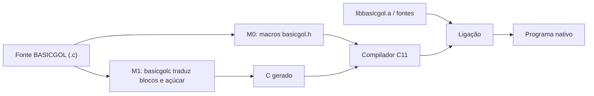

<div className="bg-hero">
  <div className="bg-eyebrow">Linguagem didática · C11 · documentação viva</div>

  # BASICGOL

  <p className="bg-lead">
    A legibilidade do BASIC e do Portugol, entregue como uma camada de macros C.
    Cada símbolo desta documentação é rastreado até o fonte, os testes e as condições
    de compilador que realmente existem no projeto.
  </p>

  [Começar agora](/guias/comecar) · [Explorar a referência](/referencia/) · [Ver os testes](/testes/)
</div>

<div className="bg-card-grid">
  <div className="bg-card">
    [**Referência viva**](/referencia/)

    Macros, palavras-chave, funções da biblioteca, expansões, contratos, exemplos e usos localizados nos testes.
  </div>

  <div className="bg-card">
    [**Testes rastreáveis**](/testes/)

    Casos dourados, entradas, saídas esperadas, negativos, avisos e modos de falha fatal — com links para as linhas.
  </div>

  <div className="bg-card">
    [**Portabilidade sem atalhos**](/guias/portabilidade)

    O que é compartilhado, o que depende de GCC/Clang/MSVC/MinGW e o que foi executado, compilado ou apenas avaliado.
  </div>

  <div className="bg-card">
    [**Por dentro do projeto**](/internos/)

    Transpilador, harness, runners Bash e scripts Python. O próprio gerador também é inventariado.
  </div>
</div>

## Sessenta segundos até o primeiro binário

BASICGOL é um `.c` comum: o cabeçalho traz as palavras-chave, a biblioteca traz os
helpers e o compilador C faz o resto.

```c
#include <basicgol.h>

INICIO
    TEXTO_FIXO(nome, 64);

    ESCREVA("Como voce se chama? ");
    SE LEIA_TEXTO(nome, TAMANHO_DE(nome)) ENTAO
        ESCREVAL("Ola, ");
        ESCREVAL(nome);
    SENAO
        ESCREVAL("nao consegui ler o nome");
    FIM_SE
FIM
```

```bash
make
cc -std=c11 -Wall -Wextra -Wformat=2 -I include programa.c \
   build/libbasicgol.a -lm -o programa
./programa
```

Se o programa usar `PARA i DE 1 ATE 10 FACA`, acrescente uma passada pelo transpilador:

```bash
build/basicgolc programa.c -o programa.gerado.c
cc -std=c11 -I include programa.gerado.c build/libbasicgol.a -lm -o programa
```

## O que você encontra aqui

| Camada | Conteúdo | Atualização |
|---|---|---|
| [Guias](/guias/) | primeiros passos, arquitetura, leitura de evidências, portabilidade, publicação | manual |
| [Referência](/referencia/) | uma página por macro/função, com expansão, contrato, guards e FAQs | gerada do código |
| [Testes](/testes/) | casos, arquivos dourados, modos fatais e cobertura | gerada dos testes |
| [Exemplos](/exemplos/) | programas completos e suas saídas | gerada de `docs/exemplos` |
| [Projeto](/projeto/) | especificação, decisões, critérios, relatórios e defeitos | importada de `docs/` |
| [Internos](/internos/) | transpilador, harness, runners e scripts Python | gerada de `tools/` e `tests/` |

### Perguntas frequentes em toda página

Cada página gerada termina com uma seção **Perguntas frequentes** específica do que ela
mostra: expansão, uso real em testes, dependência de compilador, armadilhas e como
executar. As respostas usam o código do repositório, não texto genérico.

```bash
# exemplo: conferir a FAQ e a evidência de uma macro
python3 -c "import json; d=json.load(open('website/static/api/inventario.json')); print(d['counts'])"
```

## O que torna esta documentação diferente

- **Gerada por Python a cada build.** Novos arquivos, funções, macros, casos e modos aparecem sem editar uma lista manual de páginas.
- **Evidência, não suposição.** Uma referência de teste é distinguida de uma chamada indireta; nenhuma delas é apresentada como cobertura de ramos.
- **Ramos de compilador preservados.** A análise não pré-processa o C para um único alvo: guards e diretivas continuam visíveis.
- **Histórico preservado.** A especificação, as decisões, os relatórios e a matriz original continuam disponíveis em [Projeto](/projeto/).

## Dois caminhos, uma linguagem



| Caminho | Ferramentas | Cobre |
|---|---|---|
| M0 | compilador C11 + `libbasicgol.a` | todo o subconjunto redutível a macros |
| M1 | C11 + `basicgolc` + `libbasicgol.a` | o núcleo + açúcar como `PARA i DE … FACA` |

:::note[Estado e versões]
As versões e os números impressos pelos testes são os do código executado. As páginas geradas mostram contagens estáticas do repositório e não substituem os logs de CI. Consulte a [matriz de compatibilidade](/projeto/11-matriz-compatibilidade) antes de chamar um alvo de “suportado”.
:::

## Perguntas frequentes

### BASICGOL é uma linguagem nova ou um conjunto de macros?

As duas coisas em camadas: a *linguagem* é definida pelas macros e pelo transpilador; o
que executa é C11 puro. Não há runtime próprio nem máquina virtual.

```c
#include <basicgol.h>

INICIO
    ESCREVAL("sem VM, sem interpretador");
FIM
```

### Qual compilador devo usar?

O mais disponível no seu sistema, desde que aceite C11. GCC e o frontend Clang foram
executados; MinGW-w64 foi executado em CI; MSVC é apenas avaliado. Em Linux, o comando
documentado é o do GCC/Clang com `-lm`.

```bash
cc --version
cc -std=c11 -Wall -Wextra -I include programa.c build/libbasicgol.a -lm -o programa
```

### Preciso do transpilador para tudo?

Não. Só quando o fonte usa construções que exigem reordenar tokens, como
`PARA i DE 1 ATE 3 FACA`. Sem elas, o caminho M0 compila direto.

### As FAQs são iguais em todas as páginas?

Não. Cada página monta as perguntas a partir da sua própria definição, dos usos em testes,
dos guards e do contrato editorial. Uma macro sem teste direto recebe uma resposta
diferente de uma função com 18 referências.

### Posso usar BASICGOL em produção?

O projeto declara com precisão o que foi executado e o que não foi. Para produção,
verifique a [matriz de compatibilidade](/projeto/11-matriz-compatibilidade), rode a suíte
no seu compilador/alvo e trate o que está marcado como avaliado ou não testado como
risco, não como garantia.

```bash
make test
make test-portabilidade
make test-sanitize
```

### Onde reporto um erro na documentação?

Abra um pull request no repositório. Guias ficam em `website/manuais/`, contratos
editoriais em `tools/documentacao/contratos.json` e páginas de símbolo são regeneradas do
fonte — não edite `website/docs/`.

```bash
python3 tools/gerar_documentacao.py --strict
cd website && npm run build
```
