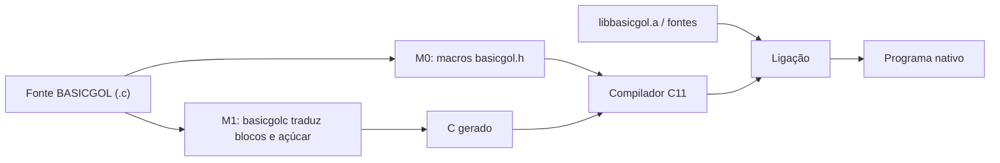

  
Linguagem didática · C11 · documentação viva

  # BASICGOL

  

    A legibilidade do BASIC e do Portugol, entregue como uma camada de macros C.
    Cada símbolo desta documentação é rastreado até o fonte, os testes e as condições
    de compilador que realmente existem no projeto.
  

  [Começar agora](/guias/comecar) · [Explorar a referência](/referencia/) · [Ver os testes](/testes/)

  

    [**Referência viva**](/referencia/)

    Macros, palavras-chave, funções da biblioteca, expansões, contratos, exemplos e usos localizados nos testes.
  

  

    [**Testes rastreáveis**](/testes/)

    Casos dourados, entradas, saídas esperadas, negativos, avisos e modos de falha fatal — com links para as linhas.
  

  

    [**Portabilidade sem atalhos**](/guias/portabilidade)

    O que é compartilhado, o que depende de GCC/Clang/MSVC/MinGW e o que foi executado, compilado ou apenas avaliado.
  

  

    [**Por dentro do projeto**](/internos/)

    Transpilador, harness, runners Bash e scripts Python. O próprio gerador também é inventariado.
  

## O que torna esta documentação diferente

- **Gerada por Python a cada build.** Novos arquivos, funções, macros, casos e modos aparecem sem editar uma lista manual de páginas.
- **Evidência, não suposição.** Uma referência de teste é distinguída de uma chamada indireta; nenhuma delas é apresentada como cobertura de ramos.
- **Ramos de compilador preservados.** A análise não pré-processa o C para um único alvo: guards e diretivas continuam visíveis.
- **Histórico preservado.** A especificação, as decisões, os relatórios e a matriz original continuam disponíveis em [Projeto](/projeto/).

## Dois caminhos, uma linguagem

:::note[Estado e versões]
As versões e os números impressos pelos testes são os do código executado. As páginas geradas mostram contagens estáticas do repositório e não substituem os logs de CI. Consulte a [matriz de compatibilidade](/projeto/11-matriz-compatibilidade) antes de chamar um alvo de “suportado”.
:::
