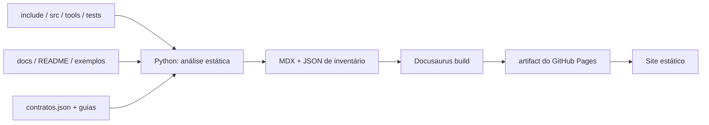

# Publicação e manutenção automática

## Pipeline



O código é a fonte dos nomes, assinaturas, expansões, guards, chamadores, casos,
arquivos dourados e linhas. `tools/documentacao/contratos.json` acrescenta explicação
editorial e armadilhas; comentários e docstrings são usados quando não há contrato
específico. Um símbolo novo ainda aparece com fonte, assinatura e evidências, mesmo que a
prosa editorial precise ser melhorada depois.

### O que é automático e o que é editorial

| Conteúdo | Origem | Precisa de revisão humana? |
|---|---|---|
| nomes, aliases, assinaturas, linhas | código | não |
| expansão de macros | corpo `#define` | não |
| guards e diretivas | `#if`/`#ifdef`/`pragma` | não |
| referências e casos | testes em disco | não |
| resumo, mecânica, cuidados, exemplos | `contratos.json` ou comentário | sim |
| perguntas frequentes | dados da página + contratos | revisão recomendada |
| guias (`website/manuais`) | escrita manual | sim |

## Rodar localmente

Linux/macOS/MSYS2:

```bash
python3 -m venv .venv
.venv/bin/python -m pip install -r tools/documentacao/requirements.txt
. .venv/bin/activate
cd website
npm ci
npm start
```

Windows PowerShell:

```powershell
py -3 -m venv .venv
.venv\Scripts\python -m pip install -r tools\documentacao\requirements.txt
.venv\Scripts\Activate.ps1
Set-Location website
npm ci
npm start
```

`npm start` gera as páginas e abre o servidor em `0.0.0.0:3000`. Para só regenerar:

```bash
python3 tools/gerar_documentacao.py --strict
python3 tools/gerar_documentacao.py --check
python3 -m unittest discover -s tests/documentacao -v
```

Use o Python do ambiente virtual se ele não estiver ativado. `--check` não escreve no
site: compara a saída determinística com os artefatos locais. O build de produção é:

```bash
cd website
npm run build
npm run serve
```

### Ciclo de trabalho recomendado

1. Edite o código ou o guia.
2. Rode `python3 tools/gerar_documentacao.py`.
3. Inspecione as páginas afetadas em `website/docs/`.
4. Rode `python3 tools/gerar_documentacao.py --check` para confirmar determinismo.
5. Rode `cd website && npm run build` antes de abrir o pull request.

O diretório `website/docs/` é gerado e não deve ser editado à mão. Ele contém um marcador
`.documentacao-gerada`; o gerador se recusa a apagar um diretório sem esse marcador.

## GitHub Pages

O workflow `.github/workflows/docs.yml`:

1. instala Python e Node com dependências fixadas;
2. gera e valida o inventário;
3. roda os testes do gerador e o typecheck;
4. compila o Docusaurus com links quebrados tratados como erro;
5. em push/Execução manual, publica o artifact com `actions/deploy-pages`.

**Configuração única do repositório:** em **Settings → Pages → Build and deployment**,
selecione **GitHub Actions** como fonte. O workflow precisa de `pages: write` e
`id-token: write`; não usa branch `gh-pages` nem token pessoal. Pull requests fazem build,
mas não publicam.

A URL padrão é `https://havaianasdestruido.github.io/BASICGOL/`. Para outro repositório ou
domínio, ajuste `DOCS_REPOSITORY_URL`, `DOCS_URL` e `DOCS_BASE_URL` no ambiente do build e
os links institucionais do config. `baseUrl` deve começar e terminar com `/`.

### Variáveis de ambiente do build

| Variável | Efeito | Padrão |
|---|---|---|
| `DOCS_URL` | URL pública usada nos metadados | `https://havaianasdestruido.github.io` |
| `DOCS_BASE_URL` | prefixo de rota do site | `/BASICGOL/` |
| `DOCS_REPOSITORY_URL` | base dos permalinks de fonte | repositório no GitHub |
| `DOCS_COMMIT` / `GITHUB_SHA` | commit usado nos permalinks | HEAD local |

```bash
DOCS_URL=https://exemplo.org DOCS_BASE_URL=/docs/ \
DOCS_COMMIT=$(git rev-parse HEAD) python3 tools/gerar_documentacao.py
```

## Adicionar uma função ou macro

1. Implemente normalmente em `include/`, `src/` ou `tools/`.
2. Adicione testes em `tests/` seguindo as convenções existentes.
3. Opcional, mas recomendado: acrescente contrato/exemplo/armadilhas em `contratos.json`.
4. Rode o gerador. A página, a assinatura, os guards e as referências aparecem
   automaticamente.

Não há lista manual de funções para atualizar. Macros curtas que expandem para uma macro
`BG_*` são agrupadas; funções públicas são agrupadas por módulo; funções internas por
arquivo.

## Adicionar um caso de teste

Crie `tests/casos/<suite>/<caso>/` com `programa.c` e os arquivos esperados. O gerador
descobre diretórios, stdin, stdout/stderr/status, alternativas e marcadores. Para o caso
ser **executado** por `make test`, a suíte também precisa estar registrada na seleção de
`tests/run.sh`; a página sinaliza quando não está.

```bash
mkdir -p tests/casos/20_minha_suite/n01_soma
cat > tests/casos/20_minha_suite/n01_soma/programa.c <<'EOF'
#include <basicgol.h>
INICIO
    ESCREVAL(2 + 3);
FIM
EOF
printf '5\n' > tests/casos/20_minha_suite/n01_soma/esperado.txt
```

## Adicionar FAQ ou explicação a uma página

As FAQs geradas não são texto solto: cada resposta é montada com dados da página. Para
melhorar uma resposta específica, edite o contrato do símbolo em `contratos.json`:

```json
{
  "symbols": {
    "bg_copia_texto": {
      "resumo": "Copia uma string NUL-terminada para capacidade explícita.",
      "cuidados": ["capacidade inclui o NUL."],
      "exemplo": "TEXTO_FIXO(d, 8);\nLOGICO ok = COPIA_TEXTO(d, TAMANHO_DE(d), origem);"
    }
  }
}
```

Para documentos importados de `docs/` e do README, as perguntas ficam na chave
`documentos`, indexada pelo nome do arquivo sem extensão:

```json
{
  "documentos": {
    "07-controle-de-fluxo": [
      {"q": "O limite final é incluído?", "a": ["Sim."], "code": "PARA (i, 1, 3) { ... }"}
    ]
  }
}
```

## Solução de problemas do build

| Sintoma | Causa | Correção |
|---|---|---|
| `ModuleNotFoundError: tree_sitter` | dependências Python ausentes | instale `tools/documentacao/requirements.txt` |
| `Documentação desatualizada` em `--check` | saída local difere do gerador | rode o gerador e revise o diff |
| `Docusaurus found broken links` | link para rota inexistente | use a rota gerada ou ajuste o guia |
| `baseUrl` inválido | falta `/` no início ou no fim | use `'/BASICGOL/'` |
| página sem FAQ | seção editorial ausente e sem dados suficientes | adicione contrato para o símbolo |
| site publicado sem CSS | `baseUrl` diferente do caminho real | alinhe `DOCS_BASE_URL` e Pages |

### Validar antes do pull request

```bash
python3 tools/gerar_documentacao.py --strict
python3 tools/gerar_documentacao.py --check
python3 -m unittest discover -s tests/documentacao -v
cd website && npm run typecheck && npm run build
```

## O que é versionado e o que é gerado

- Versionados: scripts Python, contratos, guias, configuração Docusaurus, lockfiles e
  workflow.
- Gerados a cada build: `website/docs/`, `website/static/api/`, `website/build/` e caches.
- Os documentos originais em `docs/` continuam sendo a fonte histórica; não são
  sobrescritos pelo gerador.

## Perguntas frequentes

### Preciso editar `website/docs/` para mudar uma página?

Não. Todo o diretório é regenerado. Para mudar uma página de símbolo, edite o contrato em
`tools/documentacao/contratos.json` ou o comentário no fonte. Para mudar um guia, edite
`website/manuais/`. O gerador recusa apagar um diretório sem o marcador
`.documentacao-gerada`.

### Por que o build falha com “Documentação desatualizada” se eu não mexi em nada?

Porque a saída gerada depende de todos os arquivos analisados, inclusive dos próprios
scripts do gerador. Qualquer alteração em `include/`, `src/`, `tools/`, `tests/`, `docs/`
ou nos guias muda o hash. Rode o gerador e revise o diff antes de commitar.

```bash
python3 tools/gerar_documentacao.py
python3 tools/gerar_documentacao.py --check
```

### Como o site lida com links quebrados?

`onBrokenLinks` e `onBrokenMarkdownLinks` estão em `throw`: um link para rota inexistente
falha o build de produção. Em desenvolvimento, prefira a rota completa gerada (por
exemplo `/referencia/linguagem/estrutura/se`) em vez de inventar âncoras.

### Posso publicar em outro repositório ou domínio?

Sim, ajustando `DOCS_URL`, `DOCS_BASE_URL` e `DOCS_REPOSITORY_URL`. O `baseUrl` precisa
começar e terminar com `/`. Os links institucionais do `docusaurus.config.ts` também
devem ser revistos.

```bash
DOCS_URL=https://exemplo.org DOCS_BASE_URL=/docs/ \
python3 tools/gerar_documentacao.py
```

### O que acontece se eu adicionar um caso de teste sem registrar a suíte?

O caso aparece no site, com um aviso de que o nome da suíte não foi encontrado em
`tests/run.sh`. Ele é documentado, mas não executado por `make test`. A página do caso e a
página da suíte mostram essa condição explicitamente.

### As FAQs são geradas automaticamente?

Em parte. Perguntas de páginas de símbolo, suítes, casos, modos e exemplos são montadas a
partir de dados reais da página (expansão, testes, guards, saídas douradas). Perguntas de
documentos importados vêm da chave `documentos` em `contratos.json`. Os guias têm FAQ
escrita à mão.

### O gerador executa o código C para documentar?

Não. A extração é estática, usando tree-sitter para C, Python e Shell. Isso preserva
ramos de compilador em vez de escolher um alvo e permite gerar o site sem compilar C. Os
números de execução vêm dos logs de CI, não do gerador.

### Como reproduzir o build exatamente?

Use as versões fixadas: `requirements.txt` para Python e `package-lock.json` com `npm ci`
para Node. O build é determinístico: dois builds dos mesmos insumos produzem os mesmos
hashes, e é isso que `--check` compara.

```bash
python3 -m pip install -r tools/documentacao/requirements.txt
cd website && npm ci && npm run build
```
