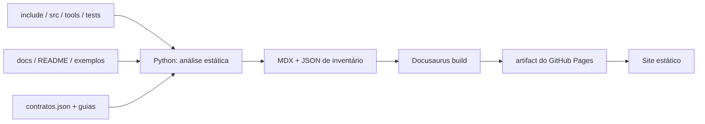

# Publicação e manutenção automática

## Pipeline



O código é a fonte dos nomes, assinaturas, expansões, guards, chamadores, casos, arquivos dourados e linhas. `tools/documentacao/contratos.json` acrescenta explicação editorial e armadilhas; comentários e docstrings são usados quando não há contrato específico. Um símbolo novo ainda aparece com fonte, assinatura e evidências, mesmo que a prosa editorial precise ser melhorada depois.

## Rodar localmente

Linux/macOS/MSYS2:

```bash
python3 -m venv .venv
.venv/bin/python -m pip install -r tools/documentacao/requirements.txt
. .venv/bin/activate
cd website
npm ci
npm start
```

Windows PowerShell:

```powershell
py -3 -m venv .venv
.venv\Scripts\python -m pip install -r tools\documentacao\requirements.txt
.venv\Scripts\Activate.ps1
Set-Location website
npm ci
npm start
```

`npm start` gera as páginas e abre o servidor em `0.0.0.0:3000`. Para só regenerar:

```bash
python3 tools/gerar_documentacao.py --strict
python3 tools/gerar_documentacao.py --check
python3 -m unittest discover -s tests/documentacao -v
```

Use o Python do ambiente virtual se ele não estiver ativado. `--check` não escreve no site: compara a saída determinística com os artefatos locais. O build de produção é:

```bash
cd website
npm run build
npm run serve
```

## GitHub Pages

O workflow `.github/workflows/docs.yml`:

1. instala Python e Node com dependências fixadas;
2. gera e valida o inventário;
3. roda os testes do gerador e o typecheck;
4. compila o Docusaurus com links quebrados tratados como erro;
5. em push/Execução manual, publica o artifact com `actions/deploy-pages`.

**Configuração única do repositório:** em **Settings → Pages → Build and deployment**, selecione **GitHub Actions** como fonte. O workflow precisa de `pages: write` e `id-token: write`; não usa branch `gh-pages` nem token pessoal. Pull requests fazem build, mas não publicam.

A URL padrão é `https://havaianasdestruido.github.io/BASICGOL/`. Para outro repositório ou domínio, ajuste `DOCS_REPOSITORY_URL`, `DOCS_URL` e `DOCS_BASE_URL` no ambiente do build e os links institucionais do config. `baseUrl` deve começar e terminar com `/`.

## Adicionar uma função ou macro

1. Implemente normalmente em `include/`, `src/` ou `tools/`.
2. Adicione testes em `tests/` seguindo as convenções existentes.
3. Opcional, mas recomendado: acrescente contrato/exemplo/armadilhas em `contratos.json`.
4. Rode o gerador. A página, a assinatura, os guards e as referências aparecem automaticamente.

Não há lista manual de funções para atualizar. Macros curtas que expandem para uma macro `BG_*` são agrupadas; funções públicas são agrupadas por módulo; funções internas por arquivo.

## Adicionar um caso de teste

Crie `tests/casos/<suite>/<caso>/` com `programa.c` e os arquivos esperados. O gerador descobre diretórios, stdin, stdout/stderr/status, alternativas e marcadores. Para o caso ser **executado** por `make test`, a suíte também precisa estar registrada na seleção de `tests/run.sh`; a página sinaliza quando não está.

Novos modos `strcmp` no harness e novas funções Bash/Python também são indexados. O [JSON de cobertura](pathname:///api/cobertura.json) ajuda a revisar símbolos ainda sem evidência direta.

## O que é versionado e o que é gerado

- Versionados: scripts Python, contratos, guias, configuração Docusaurus, lockfiles e workflow.
- Gerados a cada build: `website/docs/`, `website/static/api/`, `website/build/` e caches.
- Os documentos originais em `docs/` continuam sendo a fonte histórica; não são sobrescritos pelo gerador.

:::tip[Revisão editorial continua útil]
Automação garante descoberta e rastreabilidade, não prova que uma explicação nova está correta. Ao adicionar um contrato, revise o corpo e os testes. O gerador deliberadamente não inventa suporte de compilador nem cobertura dinâmica.
:::
